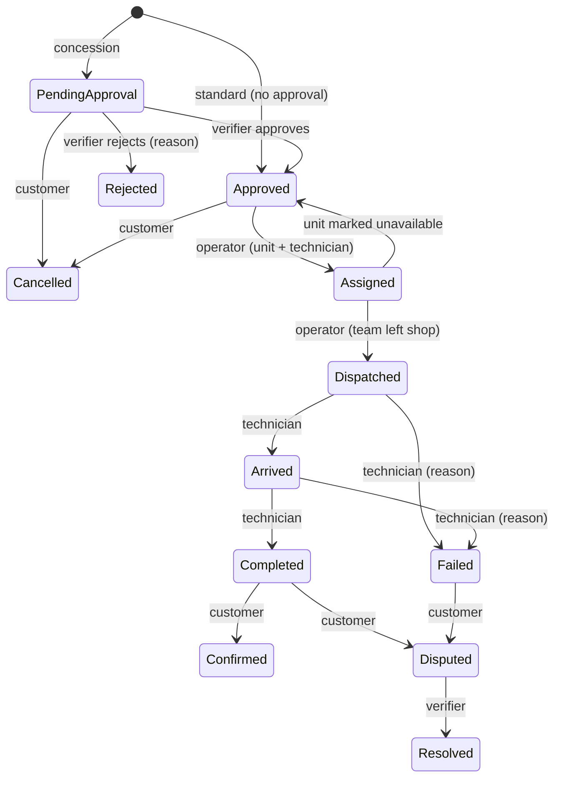
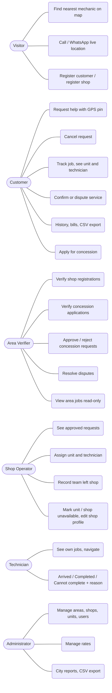

# PunctureGo – Roadside Mechanic Finder, Request & Dispatch (Frontend, Mid Evaluation)

HTML5 + **Bootstrap 5.3** + vanilla JS + **Leaflet/OpenStreetMap**. All data is loaded with **Fetch** from a mock API (`data/*.json`); writes persist in `localStorage`, so the complete workflow runs without a backend. In phase 2 only the `API` object in `js/app.js` is replaced by real endpoints.

## Scenario
Drivers stuck with a puncture, flat battery or engine fault find the nearest verified mechanic (GPS + map), call or WhatsApp them, or raise a **tracked help request**. Shops are verified by an Area Verifier, dispatch a technician and service unit, and every job is traced from request to confirmation. The system prevents a technician/unit being promised twice, shops exceeding their daily job capacity, and misuse of concession (reduced-rate) requests.

## Run
`fetch()` does not work from `file://`; serve the folder:
```
python -m http.server 8000      # open http://localhost:8000
```
GPS needs `localhost` or HTTPS. Bootstrap, icons and map tiles load from CDNs (internet required). “Reset demo data” is in every dashboard footer.

## Demo accounts (password `Pass@123`)
| Role | Email | Scope |
|---|---|---|
| Customer (concession approved, 2 open requests = at limit) | ayesha@demo.pk | |
| Customer (standard only) | bilal@demo.pk | |
| Customer (senior concession) | hamid@demo.pk | |
| Customer (concession pending) | sara@demo.pk | |
| Area Verifier | officer1@demo.pk / officer2@demo.pk / officer3@demo.pk | area 1 / 2 / 3 |
| Shop Operator | operator1@demo.pk … operator7@demo.pk | shop 1 … 7 (shop 7 is pending verification) |
| Technician | tech11@demo.pk, tech12, tech21, tech22, tech31, tech41, tech42, tech51, tech52, tech61 | own jobs only |
| Administrator | admin@demo.pk | whole city |

## Pages
`index` (public finder: map, GPS, filters, search, sort, Call / WhatsApp / Request help) · `login` · `register` (customer) · `register-shop` (mechanic, with map pin) · `customer` · `officer` · `operator` · `technician` (mobile-first) · `admin`

```
css/style.css   theme (dark navy + red), responsive tables→cards, stepper, big technician buttons, dark mode
js/app.js       config, mock API, auth, geo helpers (Haversine, GPS, Leaflet picker), business rules, modal/toast/validate/table helpers
js/<page>.js    one file per page: fetch → state → render → events
data/*.json     mock API: users areas shops units requests applications rates
```

## Mapping to the project brief
| Brief concept | PunctureGo |
|---|---|
| Zone | **Area** |
| Hydrant (daily quota, hours) | **Shop** (daily job capacity, hours, vehicles, services) |
| Tanker (sizes) | **Service unit** (Bike / Car / Rickshaw) |
| Driver | **Technician** |
| Booking | **Help request** |
| Commercial / subsidised | **Standard / concession** (senior, disability, woman travelling alone) |
| Zone Officer | **Area Verifier** (verifies shops, concessions, disputes) |
| Hydrant Operator | **Shop Operator** |

## Request life-cycle


## Use case diagram


## Permission matrix (view vs change)
| Action | Customer | Verifier | Operator | Technician | Admin |
|---|---|---|---|---|---|
| View request | own | own area (**read-only job**) | own shop | assigned only | all |
| Create / cancel request | ✔ own | – | – | – | – |
| Approve / reject concession request | – | ✔ area | – | – | – |
| Verify shops / concession applications | – | ✔ area | – | – | – |
| Assign unit + technician | – | **✘ view only** | ✔ shop | – | – |
| Team left shop | – | – | ✔ | – | – |
| Arrived / Completed / Cannot complete | – | – | – | ✔ own | – |
| Confirm / dispute | ✔ own | – | – | – | – |
| Resolve dispute | – | ✔ | – | – | – |
| Master data and rates | – | – | – | – | ✔ |

A customer sees the assigned unit plate and technician name/phone but never the technician’s other jobs; technicians load only `techId == me`.

## Rules enforced in the frontend (server re-enforces in phase 2)
* Distance = Haversine from the draggable pin; shops are re-sorted live when the pin moves or GPS locks.
* A shop is selectable only if it is **Active**, handles the vehicle and the problem, is **open now** (24/7 or within hours) and has **daily job capacity** left (live “jobs left today”).
* Concession requests need an approved concession, respect a **monthly limit** (senior 3, disability 4, woman 2), need verifier approval, and women/disability requests carry a **Priority** flag.
* A unit and a technician cannot be on two active jobs (Assigned/Dispatched/Arrived); the unit must match the vehicle type and be Available.
* Marking a unit unavailable returns its assigned jobs to the queue. Shops can mark themselves unavailable.
* Guarded status transitions (`from` list in `moveReq`) stop stale screens skipping steps; every change is logged in `history` (who, when, note).
* Validation on every form: CNIC `#####-#######-#`, phone `03XX-XXXXXXX`, WhatsApp `92XXXXXXXXXX`, vehicle no. `KHI-1234`, email, password strength, required reasons, time ranges, lat/lng ranges, uniqueness (email, CNIC, shop name/phone, plate).
* Delete guards in admin (area/shop/unit/user in use cannot be removed).

### Group variation (placeholder)
The brief mentions “the group variation” without defining it. We implemented **“max 2 open requests per customer + Priority flag for women/disability concessions”** (`CFG.MAX_OPEN`, `CFG.PRIORITY`, `Rules.openCount`, check in `customer.js`). Replace with your group’s variation if your instructor assigned a different one.

## Assumptions
1. Requests are “now” requests (ASAP); a technician/unit is busy from Assigned until Completed/Failed.
2. Shops appear publicly only when **Active**; self-registered shops start **Pending** until an Area Verifier of that area verifies them.
3. A shop belongs to one area; the Verifier of that area handles its requests, applications and disputes.
4. The capacity quota counts non-cancelled, non-rejected requests per shop per day and is released on cancel/reject.
5. Failed jobs still count against capacity; disputes can follow Completed or Failed.
6. Customers self-register (CNIC, phone); staff are created by admin; shop owners get an operator account at registration.
7. Concession “proof upload” is captured as proof type + reference number.
8. Payment is a mock “Pay now” after completion; upheld disputes mark the bill Refunded.
9. WhatsApp button sends a Google-Maps link of the pin (WhatsApp does not allow starting live-location sharing from a link).
10. Passwords are plain in the mock JSON only; phase 2 hashes them and uses token auth. Search/filter/sort/pagination are in memory now and move to SQL in phase 2.

## API contract (mock now → REST in phase 2)
Mock: `GET data/<resource>.json`. Planned (JSON, `Authorization: Bearer <token>`):

| Method & path | Role | Body / query | Success | Errors |
|---|---|---|---|---|
| GET `/api/shops` | public | `lat,lng,radius,vehicle,service,openNow,q,sort,page,size` | 200 `{items,total}` (distance computed in DB) | 400 |
| POST `/api/auth/register` · `/api/auth/register-shop` | public | customer fields / shop + owner + lat,lng | 201 | 400 validation, 409 duplicate |
| POST `/api/auth/login` | public | email, password | 200 token + user | 401 |
| GET `/api/requests` | all (scoped by role) | `q,status,page,size,sort` | 200 | 403 |
| POST `/api/requests` | customer | vehicle, vehicleNo, service, type, shopId, lat, lng, landmark, notes | 201 | 400, 409 shop closed / capacity full / open-limit, 422 concession limit |
| POST `/api/requests/{id}/cancel` | customer | – | 200 | 409 wrong status |
| POST `/api/requests/{id}/approve` · `/reject` | verifier | reason (reject) | 200 | 403 other area, 409 |
| POST `/api/requests/{id}/assign` | operator | unitId, techId | 200 | 409 unit/technician busy, vehicle mismatch |
| POST `/api/requests/{id}/dispatch` | operator | – | 200 | 409 |
| POST `/api/requests/{id}/arrive` · `/complete` · `/fail` | technician | reason (fail) | 200 | 403 not your job, 409 |
| POST `/api/requests/{id}/confirm` · `/dispute` | customer | reason (dispute) | 200 | 409 |
| POST `/api/requests/{id}/resolve` | verifier | outcome, note | 200 | 409 |
| GET/POST `/api/concession-applications`, POST `/{id}/approve|reject` | customer / verifier | category, proofType, proofNo | 201 / 200 | 409 pending exists |
| POST `/api/shops/{id}/approve` · `/reject` | verifier | reason (reject) | 200 | 403 other area |
| PATCH `/api/shops/{id}` · `/api/units/{id}` | operator (own) / admin | status, profile | 200 | 403 |
| CRUD `/api/areas` `/shops` `/units` `/users`, PUT `/api/rates/{id}` | admin | see `ENT` in `admin.js` | 2xx | 400, 409 in use |
| GET `/api/reports/summary` | admin | – | 200 aggregates | 403 |

Example request (shape = `data/requests.json` item):
```json
{"id":"RQ-1003","customerId":2,"areaId":1,"shopId":2,"vehicle":"Car","vehicleNo":"ABC-321","service":"Battery","type":"standard","lat":24.9218,"lng":67.1002,"landmark":"Nipa flyover service road","date":"2026-11-15","time":"11:00","amount":400,"payment":"Unpaid","status":"Approved","unitId":null,"techId":null,"history":[{"status":"Approved","at":"2026-11-15 11:00","by":"System","note":""}]}
```

## Responsive & accessibility
Bootstrap grid/flexbox; map above list on phones, sticky map beside list on laptops; tables become stacked cards below 768 px; tabs scroll horizontally; technician screen uses 56 px buttons and a one-tap “Navigate” link; labelled inputs, `aria-invalid`, `aria-sort`, `aria-live`, skip link, visible focus, keyboard-draggable pin, light/dark toggle.

## Tested
Scripted checks in a simulated browser: every page renders with seeded roles without errors; empty-form validation; valid request creation; third open request blocked; assign validation; assign → dispatch → arrived → failed(reason) chain; verifier approve; shop verification. Please also open it in a real browser at 360 px and laptop width before submission.
